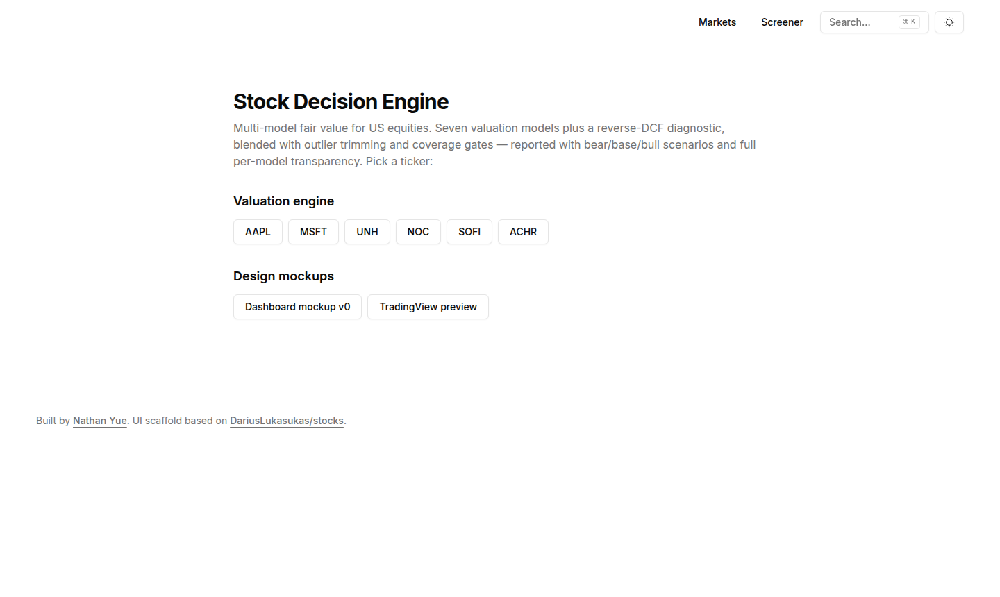
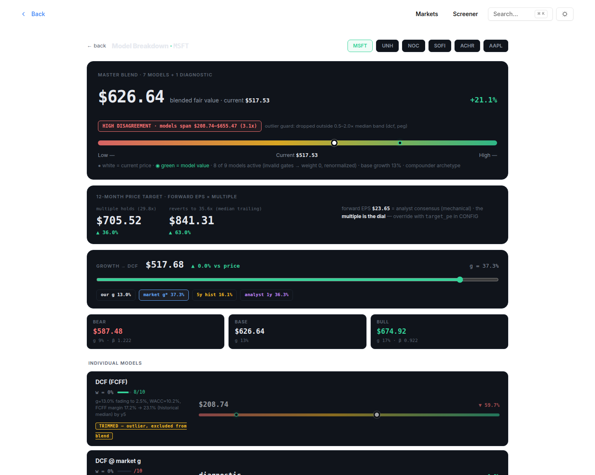

# Stock Decision Engine

A full-stack equity research tool that turns raw financial statements into an
**allocation decision**: a master fair-value estimate, bear/base/bull scenarios,
and a 6–12 month price target — instead of another 100-row financial table.

Built by [Nathan Yue](https://github.com/GenesisGGGG). Frontend in Next.js 14,
valuation core in Python.





## What it does

1. **Pulls fundamentals** via `yfinance` (statements, balance sheets, prices, splits)
2. **Values each stock with 7 independent models** — DCF (FCFF), reverse-DCF
   diagnostic, trailing P/E, PEG, EV/EBITDA, P/S, P/B, and residual income —
   each with its own validity gates and fallbacks
3. **Blends the survivors**: invalid models are dropped, outliers beyond 2×
   the median are trimmed, weights are renormalized, and the master value is
   *withheld* (rather than guessed) when computable coverage falls below 35%
4. **Produces bear/base/bull scenarios** and a 12-month price target, and
   writes one auditable JSON per ticker — every fallback and clamp is logged
5. **Renders it all** in a decision-first UI: master dial, price-target range,
   model breakdown, and only the ~24 metrics that matter, each with market /
   sector context

The engine's full specification — input fallbacks, clamps, model formulas,
blend logic, known approximations — is documented in
[`engine/README_AUDIT.md`](engine/README_AUDIT.md).

## Architecture

```
engine/engine.py  ──yfinance──▶  per-ticker JSON  ──▶  Next.js app renders it
  7 valuation models                 (public/valuation/)      ├─ /valuation/[ticker]
  + 1 diagnostic                                            ├─ /screener
  blend + scenarios                                         └─ /stocks/[ticker]
```

The Python engine is the entire calculation layer; the site only renders the
JSONs it produces. Offline tests (`engine/test_engine.py`) run the models
against synthetic statements with no network access.

## Running it

**Engine** (writes JSONs to `public/valuation/`):

```bash
cd engine
pip install yfinance pandas
python3 engine.py AAPL MSFT        # or no args for the built-in ticker set
python3 test_engine.py             # offline, no network
```

**Web app**:

```bash
npm install
npm run dev
```

## Design notes

- **Decision-first, not data-first.** The UI is built around one question —
  *what's this stock worth and what do I do* — with data density treated as a
  cost, not a feature. Layout reference: Finviz fundamentals, Simply Wall St
  snowflake (but with formulas published).
- **Withholding is a feature.** When the models can't cover a stock, the
  engine says so instead of emitting a confident number.
- **Every judgment is disclosed.** Analyst-assumed growth rates per ticker,
  calibration constants (ERP, terminal growth, PEG anchor), and every clamp that
  binds are visible in the output `warnings`.

## Stack

Next.js 14 (App Router) · TypeScript · Tailwind · shadcn/ui · Recharts/Visx ·
Python · yfinance · pandas

UI scaffold based on [DariusLukasukas/stocks](https://github.com/DariusLukasukas/stocks) (MIT).

## Disclaimer

Research/educational tool. Data via unofficial Yahoo Finance endpoints; verify
before trading. Not investment advice.
